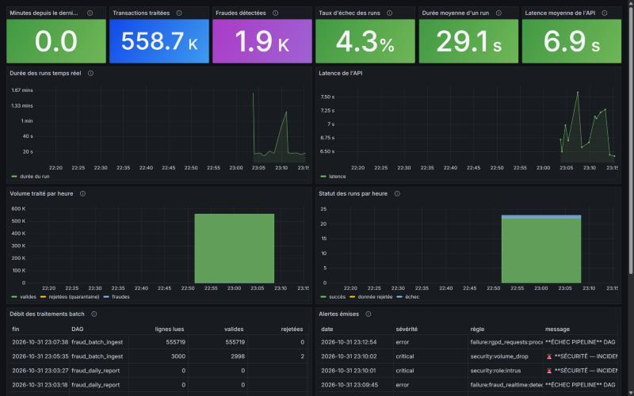

# Pipeline de détection automatique de fraude bancaire

Pipeline de données orchestré avec **Apache Airflow** : il récupère des transactions bancaires en
continu (API) ou par fichiers, contrôle leur qualité, les classe avec un modèle de machine learning,
alerte sur Discord en cas de fraude, historise tout en PostgreSQL, produit un rapport chaque matin,
se surveille lui-même (Grafana + règles d'alerte) et applique les obligations du RGPD.

Projet réalisé dans le cadre du bloc **BC03 — Orchestration de données** (titre RNCP 41993 délivré par Jedha).

---

## Sommaire

- [Architecture](#architecture)
- [Stack technique](#stack-technique)
- [Structure du projet](#structure-du-projet)
- [Installation](#installation)
- [Les six DAGs](#les-six-dags)
- [Performances mesurées](#performances-mesurées)
- [Gestion des erreurs et reprise](#gestion-des-erreurs-et-reprise)
- [Monitoring](#monitoring)
- [RGPD et sécurité](#rgpd-et-sécurité)
- [Configuration à chaud](#configuration-à-chaud)
- [Le modèle de détection](#le-modèle-de-détection)
- [Démonstration](#démonstration)
- [Qualité du code et tests](#qualité-du-code-et-tests)
- [Dépannage](#dépannage)
- [Limites et pistes d'amélioration](#limites-et-pistes-damélioration)

Documentation, dans [`docs/`](docs/) : [`ARCHITECTURE.md`](docs/ARCHITECTURE.md) (justification de chaque
choix), [`MONITORING.md`](docs/MONITORING.md) (métriques, tableau de bord, alertes) et
[`RGPD.md`](docs/RGPD.md) (registre des traitements, droits, violations de données).

---

## Architecture

```
① Entraînement (une fois, dans le worker)
   fraudTest.csv ──> train_model.py ──> fraud_model.pkl + model_card.json (version, métriques)

② Temps réel (toutes les minutes)                         ③ Fichiers (dépôt dans data/inbox/)
   API Hugging Face ──> fraud_realtime                        CSV / JSON / Parquet ──> fraud_batch_ingest
        filtrage 7/21 colonnes · contrôle qualité                  lots de 50 000 lignes · quarantaine
        modèle ──> alerte Discord si fraude                         │
        │                                                           │
        └──────────── upsert ──> fraud-db (PostgreSQL) <────────────┘
                                   │  public.transactions / rejected_transactions
                                   │  monitoring.pipeline_runs / alerts      ──> Grafana (lecture seule)
                                   │  audit.journal
④ Chaque matin à 8h              │
   fraud_daily_report ──> data/reports/report_<date>.csv + summary_<date>.txt

⑤ Toutes les 10 min : pipeline_monitoring ──> règles d'alerte + contrôles de sécurité ──> Discord
⑥ Chaque nuit à 2h  : rgpd_maintenance    ──> sauvegarde, purge des données échues
⑦ À la demande      : rgpd_requests       ──> accès / rectification / effacement
```

> **L'API Hugging Face** (`/current-transactions`) est une **source de données**, pas un service de
> prédiction. Elle renvoie 21 colonnes, dont `is_fraud` — la vérité terrain du dataset — et des
> données personnelles (`cc_num`, `first`, `last`, `street`, `dob`, `job`, `gender`).
> `fetch_transactions` n'en conserve que **7** (`CHAMPS_CONSERVES`) : le reste n'entre jamais dans
> le système.

---

## Stack technique

| Composant | Rôle |
|---|---|
| **Apache Airflow 2.10.5** (CeleryExecutor) | Orchestration des six DAGs |
| **Docker Compose** | Toute la stack en une commande |
| **PostgreSQL 13** (`postgres`) | Base de métadonnées Airflow (non exposée) |
| **PostgreSQL 16** (`fraud-db`, port 5433) | Base métier : transactions, métriques, journal d'audit |
| **Redis 7.2** | Broker Celery |
| **Grafana 11.2** (port 3000) | Tableau de bord de suivi du pipeline |
| **scikit-learn 1.1** — RandomForestClassifier | Classification des transactions |
| **Discord Webhook** | Alertes fraude, échec, monitoring, sécurité |
| **pytest · ruff · GitHub Actions** | Tests, lint, intégration continue |

---

## Structure du projet

```
fraud-pipeline/
├── dags/
│   ├── fraud_realtime_dag.py         # DAG 1 — détection temps réel (toutes les minutes)
│   ├── fraud_daily_report_dag.py     # DAG 2 — rapport quotidien (8h)
│   ├── fraud_batch_ingest_dag.py     # DAG 3 — ingestion de fichiers (CSV, JSON, Parquet)
│   ├── pipeline_monitoring_dag.py    # DAG 4 — règles d'alerte + contrôles de sécurité (10 min)
│   ├── rgpd_maintenance_dag.py       # DAG 5 — sauvegarde + purge (2h)
│   ├── rgpd_requests_dag.py          # DAG 6 — droits des personnes (manuel)
│   ├── sql/schema.sql                # schéma de fraud-db (idempotent)
│   ├── .airflowignore
│   └── fraud_pipeline/               # logique partagée, testable sans Airflow
│       ├── config.py                 #   constantes, réglages par défaut
│       ├── alerts.py                 #   Discord + déduplication
│       ├── quality.py                #   contrôles qualité
│       ├── model.py                  #   chargement et version du modèle
│       ├── storage.py                #   upsert, quarantaine, journal d'audit
│       ├── monitoring.py             #   métriques de run, règles d'alerte
│       ├── security.py               #   détection d'incidents
│       └── rgpd.py                   #   droits, rétention, sauvegardes
├── data/
│   ├── train_model.py                # entraînement (à lancer une fois)
│   ├── fraudTest.csv                 # dataset Kaggle (non versionné)
│   ├── fraud_model.pkl, model_card.json   # générés (non versionnés)
│   ├── inbox/ archive/ error/        # ingestion batch
│   ├── reports/ backups/ rgpd_exports/
├── fraud-db/init/01_roles.sh         # rôle Grafana en lecture seule
├── grafana/                          # source de données + tableau de bord versionnés
├── tests/                            # pytest : qualité, monitoring, intégrité des DAGs
├── docs/                             # ARCHITECTURE.md, MONITORING.md, RGPD.md, schéma d'infrastructure, capture Grafana
├── .github/workflows/ci.yml          # lint + tests à chaque push
├── docker-compose.yaml · Dockerfile · requirements*.txt · pyproject.toml
└── .env.example                      # modèle de configuration (le .env n'est jamais versionné)
```

---

## Installation

Prérequis : **Docker Desktop** (4 Go de RAM, 2 CPU minimum), le dataset **`fraudTest.csv`**
([Kaggle](https://www.kaggle.com/datasets/kartik2112/fraud-detection)) à placer dans `data/`, et
un webhook Discord.

### 1. Configurer l'environnement

```bash
cp .env.example .env
```

Renseigner dans `.env` les valeurs marquées *(obligatoire)* : la stack refuse de démarrer sans
elles. Les commandes pour générer la clé Fernet et la clé de session sont dans le fichier.

### 2. Démarrer la stack

```bash
docker compose up -d --build
```

Une seule commande : Airflow, `fraud-db` (schéma créé automatiquement), Redis et Grafana. La
connexion `postgres_fraud` est fournie par variable d'environnement — rien à saisir dans
l'interface.

- Airflow : **http://localhost:8080**
- Grafana : **http://localhost:3000** (tableau de bord « Pipeline de détection de fraude »)

Les ports ne sont publiés que sur `127.0.0.1` : inaccessibles depuis le réseau.

### 3. Entraîner le modèle (une seule fois)

Dans le conteneur, pour que le `.pkl` soit écrit et relu par la même version de scikit-learn :

```bash
docker compose exec airflow-worker bash -c "cd /opt/airflow/data && python train_model.py"
```

Durée mesurée : ~22 s. Produit `fraud_model.pkl` et `model_card.json` (version, métriques).

### 4. Activer les DAGs

Dans l'interface Airflow, activer les six DAGs (ou `airflow dags unpause <dag_id>`).

---

## Les six DAGs

| DAG | Planification | Rôle |
|---|---|---|
| `fraud_realtime` | `*/1 * * * *` | API → filtrage → qualité → modèle → alerte → upsert → métriques |
| `fraud_daily_report` | `0 8 * * *` | Rapport de la veille (CSV + résumé), avec rattrapage automatique |
| `fraud_batch_ingest` | `*/5 * * * *` + dépôt de fichier | Ingestion CSV / JSON / JSON Lines / Parquet par lots |
| `pipeline_monitoring` | `*/10 * * * *` | Règles d'alerte sur les métriques, contrôles de sécurité |
| `rgpd_maintenance` | `0 2 * * *` | Sauvegarde, purge des données au-delà de la durée de conservation |
| `rgpd_requests` | manuel (formulaire) | Accès, rectification, effacement |

### `fraud_realtime`

```
create_tables → fetch_transactions → detect_fraud ─┬─ send_notification ─┬→ store_in_db → record_metrics
                                                   └─ no_fraud ──────────┘
```

| Tâche | Rôle |
|---|---|
| `create_tables` | Schéma idempotent (`sql/schema.sql`) |
| `fetch_transactions` | Appel API (latence mesurée), filtrage 7/21 colonnes, contrôle qualité. Invalide → quarantaine, run terminé proprement |
| `detect_fraud` | Probabilité de fraude, aiguillage selon le seuil (`BranchPythonOperator`) |
| `send_notification` / `no_fraud` | Alerte Discord ou branche neutre |
| `store_in_db` | **Upsert** sur `trans_num` : un rejeu ne crée jamais de doublon (`trigger_rule="all_done"`) |
| `record_metrics` | Écrit les métriques du run, puis fait échouer le run si une tâche a échoué |

Pourquoi `record_metrics` relance l'échec : Airflow juge l'état d'un run sur ses tâches terminales.
Comme `store_in_db` est en `all_done`, un run dont l'appel API avait échoué finissait « vert ». Le
run est désormais rouge, et l'échec reste mesuré.

### `fraud_daily_report`

`extract_yesterday → generate_report → record_metrics`. Le rapport compte les décisions de la
journée (filtre sur `updated_at`, date du dernier scoring). La date vient de `data_interval_start`
(idempotent, rejouable). `catchup=True` + `max_active_runs=1` : si la plateforme a été arrêtée
plusieurs jours, les rapports manquants sont produits un par un au redémarrage. Le résumé indique
total, fraudes, taux, montant fraudé, répartition par source et top 5 des catégories.

### `fraud_batch_ingest`

`detect_new_files → ingest_files → record_metrics`. Un fichier déposé dans `data/inbox/` est traité
dans les 5 minutes : lecture par lots de 50 000 lignes (mémoire bornée), seules les 7 colonnes
autorisées sont conservées, lignes invalides en quarantaine, fichier archivé dans `data/archive/`. Un
fichier illisible part dans `data/error/` (alerte Discord) sans bloquer les autres.

---

## Performances mesurées

Mesures réelles du 31/10/2026 (Docker Desktop, poste de développement), enregistrées dans
`monitoring.pipeline_runs` :

| Indicateur | Valeur |
|---|---|
| Durée d'un run temps réel (API → base) | **17 à 19 s**, dont 6,5 à 7 s de latence de l'API |
| Ingestion batch du dataset complet (555 719 lignes) | **36,7 s — 15 150 lignes/s** (contrôle + scoring + upsert) |
| Ingestion de 3 fichiers de 1 000 lignes (CSV, JSONL, Parquet) | 1,7 s — 1 730 lignes/s |
| Rapport quotidien (extraction + écriture) | ~5 s |
| Entraînement du modèle | ~22 s |

Le débit batch montre que le goulot du temps réel n'est pas le pipeline mais l'API (1 transaction
par appel, ~7 s de latence, 5 appels/min maximum).

---

## Gestion des erreurs et reprise

| Situation | Comportement |
|---|---|
| API indisponible / lente | 2 nouvelles tentatives avec délai exponentiel (10 s, 20 s) ; `max_active_runs=1` évite les chevauchements ; `dagrun_timeout` 5 min |
| Format de l'API modifié, valeur aberrante | Contrôle qualité → table `rejected_transactions` avec la raison ; le run se termine sans échec |
| Fichier batch corrompu | Déplacé dans `data/error/`, alerte, les autres fichiers continuent |
| Tâche en échec | Alerte Discord « ÉCHEC PIPELINE » (erreur + lien vers les logs), dédupliquée 30 min ; run marqué en échec |
| Rejeu d'une tâche ou d'un run | Upsert sur `trans_num` : aucun doublon, reprise sans nettoyage |
| Plateforme arrêtée plusieurs jours | Rapports quotidiens manquants rattrapés automatiquement (`catchup`) |
| Conteneur arrêté | `restart: always` + healthchecks sur tous les services |
| Perte de données | Sauvegarde quotidienne des tables (`data/backups/`, 7 jours) |

---

## Monitoring

Détails : [`docs/MONITORING.md`](docs/MONITORING.md).

- **Métriques** : chaque run de chaque DAG écrit une ligne dans `monitoring.pipeline_runs` — durée,
  statut, tâches en échec, lignes lues / valides / rejetées, fraudes, débit, latence de l'API,
  version du modèle, plus un champ JSON libre pour toute nouvelle métrique.
- **Tableau de bord Grafana** (http://localhost:3000), rafraîchi toutes les 30 s : fraîcheur, volumes,
  durées, latence, taux d'échec, débit batch, historique des alertes.
- **Alertes proactives** (`pipeline_monitoring`, toutes les 10 min) : pipeline arrêté, taux d'échec,
  durée dégradée, API lente, taux de rejet qualité, dérive du taux de fraude, rapport quotidien
  manquant. Seuils modifiables à chaud (Variable `monitoring_thresholds`).



---

## RGPD et sécurité

Détails : [`docs/RGPD.md`](docs/RGPD.md) (registre de traitement, procédures).

| Exigence | Mise en œuvre |
|---|---|
| Minimisation | 7 colonnes sur 21 conservées à l'entrée ; aucune donnée directement identifiante stockée |
| Sécurité | Secrets dans `.env` (non versionné) ; clé Fernet obligatoire (connexions chiffrées) ; mots de passe SCRAM-SHA-256 ; Grafana en lecture seule sur le seul schéma `monitoring` ; ports sur `127.0.0.1` |
| Droits des personnes | DAG `rgpd_requests` : accès (export JSON), rectification, effacement |
| Conservation | Purge automatique au-delà de 90 jours (`retention_days`), quarantaine 30 jours, fichiers (rapports, exports, fichiers source déposés) 30 jours |
| Traçabilité | Chaque ligne porte `source`, `dag_run_id`, `model_version`, dates ; `audit.journal` trace accès, rectifications, effacements, purges, sauvegardes, incidents ; PostgreSQL journalise connexions et DDL |
| Violations de données | `pipeline_monitoring` détecte rôles et sessions non autorisés et disparitions de données non journalisées → journal + alerte SÉCURITÉ ; procédure 72 h dans `docs/RGPD.md` |

---

## Configuration à chaud

Variables Airflow, prises en compte au run suivant sans redémarrage :

| Variable | Défaut | Effet |
|---|---|---|
| `fraud_threshold` | `0.5` | Seuil de décision ; l'abaisser augmente le rappel au prix de faux positifs |
| `demo_fraud` | `0` | À `1`, rejoue une fraude connue au lieu d'appeler l'API |
| `retention_days` | `90` | Durée de conservation des transactions |
| `rejected_retention_days` | `30` | Durée de conservation de la quarantaine |
| `files_retention_days` | `30` | Rapports, exports RGPD, fichiers source archivés ou en erreur |
| `backups_kept` | `7` | Nombre de sauvegardes conservées |
| `monitoring_thresholds` | voir `config.py` | JSON ; on peut ne surcharger qu'un seuil, ex. `{"duration_p95_s": 60}` |

```bash
docker compose exec airflow-worker airflow variables set fraud_threshold 0.3
```

---

## Le modèle de détection

**RandomForestClassifier** (`class_weight="balanced"`) sur 4 variables stables dans le temps :
`amt`, `city_pop`, `merch_lat`, `merch_long`. Sur le jeu de test : **recall 0,31**, **precision
0,72**, F1 0,43 (matrice de confusion dans `model_card.json`). L'accuracy (99,7 %) n'est pas
suivie : un modèle qui ne détecte jamais rien atteint 99,6 %.

La version du modèle (`rf-<date>-<empreinte>`) est enregistrée avec chaque prédiction : on sait quel
modèle a pris chaque décision.

### Le bug corrigé : pourquoi aucune fraude n'était détectée

À l'origine le pipeline ne détectait **jamais** de fraude — 0 sur ~6000 transactions. Le champ
`current_time` de l'API est en **millisecondes**, la colonne `unix_time` du dataset en **secondes** et
couvre 2013. Même converti, un horodatage de 2026 reste hors de la plage apprise : un timestamp
absolu est toujours hors distribution en production. **Le temps a été retiré des variables** ; le
rappel effectif est passé de ~0 % à ~30 %.

---

## Démonstration

Une vraie fraude n'apparaît que toutes les ~250 minutes (0,4 % des transactions). Pour la montrer :

```bash
docker compose exec airflow-worker airflow variables set demo_fraud 1
```

```bash
docker compose exec airflow-worker airflow dags trigger fraud_realtime
```

La branche `send_notification` passe au vert, l'alerte Discord part, la ligne est stockée avec
`source = demo`. Rejouer le mode démo ne crée pas de doublon (upsert). Repasser ensuite à `0` :

```bash
docker compose exec airflow-worker airflow variables set demo_fraud 0
```

Autres démonstrations : déposer un fichier dans `data/inbox/` (ingestion batch), déclencher
`rgpd_requests` avec un `trans_num` (formulaire de l'interface), ouvrir Grafana.

---

## Qualité du code et tests

- Logique métier dans le paquet `dags/fraud_pipeline/`, séparée de la déclaration des DAGs.
- Style vérifié par **ruff** (PEP 8, ordre des imports, pièges courants) — configuration dans
  `pyproject.toml`.
- **29 tests pytest** : contrôles qualité, règles d'alerte, métriques, détection de suppression,
  intégrité des six DAGs (chargement, structure, alerte d'échec sur chaque tâche).
- **Intégration continue** (`.github/workflows/ci.yml`) : lint + tests à chaque push, et chargement
  des DAGs dans l'image Docker.

```bash
docker compose exec airflow-worker bash -c "cd /opt/airflow && pytest -v tests"
```

---

## Dépannage

| Symptôme | Cause probable et solution |
|---|---|
| `docker compose up` refuse de démarrer (« Définir … dans .env ») | Variable obligatoire vide dans `.env` |
| Conteneurs non `healthy` | Moins de 4 Go de RAM alloués à Docker |
| `password authentication failed` sur `fraud-db` | Mot de passe changé dans `.env` après la création du volume : le volume garde l'ancien. Remettre l'ancien, ou recréer le volume (`docker compose down -v`, perte des données) |
| Port déjà utilisé | Changer `AIRFLOW_WEB_PORT`, `FRAUD_DB_PORT` ou `GRAFANA_PORT` dans `.env` |
| Erreur au chargement du `.pkl` | Modèle entraîné hors du conteneur : relancer l'étape 3 |
| Aucune alerte Discord | `DISCORD_WEBHOOK_URL` absente, ou conteneurs non recréés (`docker compose up -d`) |
| Toujours `no_fraud` | Normal (~0,4 % de fraudes) ; utiliser `demo_fraud=1` |
| Alerte « Aucun run temps réel réussi » | `fraud_realtime` en pause ou en échec continu : voir Grafana puis les logs |
| Panneaux Grafana vides | Aucun run encore enregistré, ou mauvais `GRAFANA_DB_PASSWORD` |

Rotation de la clé Fernet : ajouter la nouvelle clé devant l'ancienne
(`AIRFLOW__CORE__FERNET_KEY=nouvelle,ancienne`), redémarrer, lancer
`airflow rotate-fernet-key`, puis retirer l'ancienne.

---

## Limites et pistes d'amélioration

- **Hôte unique** : la machine reste un point de défaillance unique. Étape suivante : PostgreSQL
  managé (réplication), workers Celery sur plusieurs machines (`docker compose up --scale
  airflow-worker=2` fonctionne déjà en local), sauvegardes copiées hors de l'hôte.
- **Rappel de 30 %** : des variables dérivées (écart à la position habituelle du client, fréquence
  des transactions) amélioreraient la détection.
- **Pas de réentraînement automatisé** : un DAG dédié pourrait réentraîner et comparer les versions
  (MLflow), en s'appuyant sur l'alerte de dérive déjà en place.
- **Chiffrement** : pas de TLS ni de chiffrement au repos sur `fraud-db` (acceptable sur un réseau
  Docker local, à ajouter avant toute exposition).
